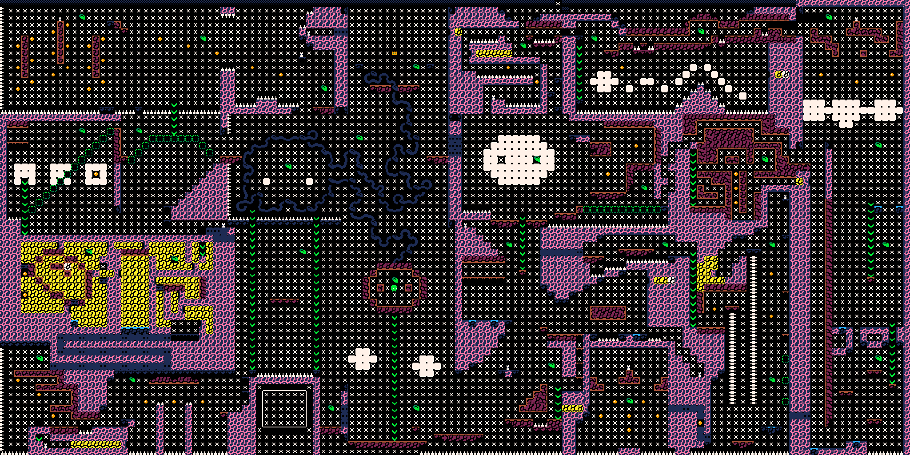

# PICO-8 map renderer

Render a PICO-8 cart's map layer to a PNG, including the lower half of maps
taller than 32 tiles.

```sh
node render.mjs game.js map.png --scale 3 --rows 64
```



*Example output: the complete world map of [Moss Moss](https://noelcody.itch.io/moss-moss)
by Noel Cody, rendered with this tool and published in the
[Moss Moss map guide](https://mossmoss.net/guides/moss-moss-full-map/).*

## Why

PICO-8 keeps the map in 128×32 tiles at `0x2000`. A game that needs a taller
world uses the area at `0x1000` — the lower half of the sprite sheet — as map
rows 32 to 63. That is a standard trick, and it is also why a naive renderer
stops halfway down the world: it only reads `0x2000`.

This tool reads both regions, draws each tile with the cart's own sprite
graphics and the fixed 16-colour palette, and writes a PNG with no dependencies
beyond Node itself.

## Usage

```sh
node render.mjs <cart.js> <out.png> [--scale N] [--rows 32|64]
```

- `cart.js` is the JavaScript export PICO-8 produces for the web player — the
  file containing `var _cartdat=[...]`. The tool reads the 32768-byte ROM data
  directly; it does not need a `.p8.png` or the PICO-8 binary.
- `--scale` multiplies each pixel (default 3, allowed 1–8).
- `--rows` renders 64 map rows (default) or only the standard 32.

```sh
node test.mjs
```

The test builds a synthetic cart in memory, renders it, and checks the PNG
header and dimensions, so it runs without any game files.

## How it works

| Region | Offset | Use |
| --- | --- | --- |
| Sprite sheet | `0x0000`–`0x1FFF` | 128×128 pixels, 4 bits per pixel, two pixels per byte |
| Map rows 0–31 | `0x2000`–`0x2FFF` | 128 bytes per row, one tile per byte |
| Map rows 32–63 | `0x1000`–`0x1FFF` | shared with the lower half of the sprite sheet |

Each map byte is a sprite index: `x = (index % 16) * 8`, `y = floor(index / 16) * 8`
in the sprite sheet. Pixels are stored low nibble first.

## Limits

- Map tiles only: sprites and objects drawn by code at runtime are not part of
  the map layer and will not appear.
- No sprite flags, custom palettes, or palette swaps are applied.
- The JS export format only; `.p8` text carts are not parsed.
